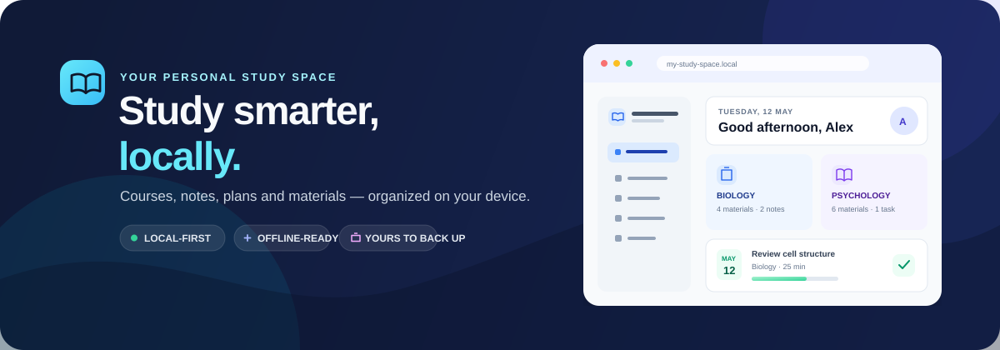
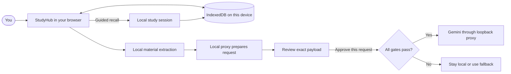

# College Study Hub

<p align="center">
  
</p>

<div align="center">

  
  
  
  
  

  <h3>Study smarter, locally.</h3>

  <p>
    A personal, browser-first college study workspace for modules, materials, notes,
    tasks, study plans, backups, and optional AI review — all kept local to your machine.
  </p>

</div>

StudyHub is a local-first study workspace for organizing college modules, course materials, notes, tasks, study sessions, and backups. It runs entirely in the browser with Dexie/IndexedDB, has no account system or cloud sync, and keeps your study data on-device unless you explicitly export a backup. The optional AI workflow uses a same-machine loopback proxy only after configuration, activation, and per-request approval.

<p align="center">
  <a href="#quick-start">Get started</a> ·
  <a href="#core-features">Explore features</a> ·
  <a href="#privacy-data-and-backups">Privacy & data</a> ·
  <a href="#development-and-quality-checks">Run checks</a>
</p>

## Why it exists

- Organize modules, topics, materials, and notes without a backend.
- Keep study files local and inspectable in-browser.
- Review PDFs, documents, images, markdown, code, and text sources directly.
- Plan tasks and study sessions with local active recall.
- Back up or restore your workspace intentionally and safely.
- Use optional AI help only when the local proxy is enabled and reviewed.

## Core features

- Modular study organization for course content and materials
- Import and manage study files in browser-local IndexedDB
- Preview PDFs, images, DOCX, PPTX, XLSX, Markdown, and plain text files
- Write and search notes with markdown preview, tags, pins, and links
- Track assignments, dates, priorities, and completion state
- Plan study sessions and guided recall from linked material
- Export full or module-scoped ZIP backups and restore them safely
- Run the app shell offline after a successful online load in a supporting browser

## How it works



Study records and imported files stay in the current browser profile and origin.
Optional provider requests are a separate, explicit path: selected extracted
text is prepared locally, shown for review, and sent only after fresh approval
and all runtime gates pass.

## Optional Gemini AI support

The optional AI flow is intentionally conservative, local, and off by default.

- The AI feature is designed around the loopback-only proxy in `docs/AI_PLAN.md`
- It is disabled unless `STUDY_HUB_AI_ENABLED=1` is set on the server process
- It sends only reviewed text for the selected material, never full app state
- It requires fresh explicit approval of the exact payload before dispatch
- It preserves local fallbacks and avoids any network request when fallback is used
- The browser never stores the Gemini key; DPAPI-protected server-side storage is used on Windows

This workflow is built for personal coursework use and remains subject to the project’s documented terms, approval gates, and local activation checks. See `docs/AI_PLAN.md` and `docs/AI_LAUNCH_CHECKLIST.md` for the full design and launch policy.

## Quick start

### Windows setup

```powershell
.\scripts\setup-study-hub.ps1
```

This checks Node/npm compatibility, installs dependencies from the lockfile, builds the app, and starts it locally. It does not change your browser data or system-wide settings.

### Development

```powershell
npm ci
npm run dev
```

The dev and preview commands set `STUDY_HUB_AI_ENABLED=1` before the Node process starts the local server. Production startup and Windows startup do the same.

### Production preview

```powershell
npm run build
npm run start
```

The default local URL is:

- `http://127.0.0.1:4173`

If that port is occupied, Vite selects the next available port and prints the actual URL.

### Windows automatic startup

```powershell
.\scripts\install-startup.ps1
```

This creates a per-user startup shortcut for this checkout and launches the built server at sign-in, with the AI proxy flag set for the Node process before launch.

Other startup-related commands:

```powershell
.\scripts\install-startup.ps1 -OpenBrowserAtSignIn
.\scripts\start-study-hub.ps1 -OpenBrowser
.\scripts\stop-study-hub.ps1
.\scripts\uninstall-startup.ps1
```

## Requirements

- Windows 10/11 for the PowerShell setup and startup scripts
- Node.js 22.12+ (22.x), 24.x, or 26+
- npm 10+
- A modern browser with IndexedDB support

## Privacy, data, and backups

StudyHub stores study records, settings, and imported file bytes in IndexedDB for the current browser profile and origin on this computer. Data is not synced to another browser, profile, computer, or repository clone.

### Backup model

Use the built-in backup flow to export either:

- A full-library ZIP containing all records, settings, and referenced material files
- A module-scoped ZIP for a selected course module

Restore is validated before writing and supports merge or replace flows. Conflicting IDs and module codes are surfaced instead of silently overwritten.

### Offline and service worker behavior

The service worker caches only the app shell and same-origin static assets. It does not cache study content and does not send it to a server. Offline launch requires a successful first online load and browser support for service workers.

### AI privacy notes

AI prompts, outputs, and request history are not written to IndexedDB. The project records only local operational state, such as the launch artifact and activation metadata, in the local `.study-hub/` directory. The actual provider request is governed by the provider's own terms and the project’s explicit approval flow.

The owner reports that Google confirmed the intended personal coursework use. No written response was available to the repository, so the project records that as a limited owner report rather than broader approval evidence.

## Development and quality checks

Run the standard checks from the project root:

```powershell
npm run test
npm run test:server
npm run lint
npm run typecheck
npm run build
```

The project also includes Node-based server checks and Vite-based browser tests. CI runs the same suite on supported Node versions.

## Project structure

- `src/` — React + TypeScript app logic and feature modules
- `server/` — optional local AI proxy and request validation logic
- `scripts/` — setup, startup, stop, and production-serving scripts
- `public/` — static assets including the service worker
- `docs/` — architecture, AI design, and project documentation

## Troubleshooting

- **Node/npm version error:** install a supported Node version and reopen PowerShell
- **Port conflict:** use the printed URL or set `$env:STUDY_HUB_PORT = "4300"`
- **Startup shortcut not working:** inspect logs under `%LOCALAPPDATA%\CollegeStudyHub`
- **Missing study records:** check that you are using the same browser profile and origin
- **No production build:** run `npm run build` or rerun the setup script

## License

There is currently no `LICENSE` file in the repository. That means no explicit open-source license has been chosen yet. If you plan to publish or redistribute this project, add a license intentionally before doing so.

## Repository guide

- `src/` — app features, pages, services, repositories, and UI
- `server/` — Vite server-side AI proxy and validation logic
- `scripts/` — Windows setup and local startup helpers
- `public/sw.js` — app-shell service worker
- `docs/` — architecture and AI design documentation
- `docs/AI_PLAN.md` — phased AI proxy design
- `docs/AI_LAUNCH_CHECKLIST.md` — launch gates and activation checklist
